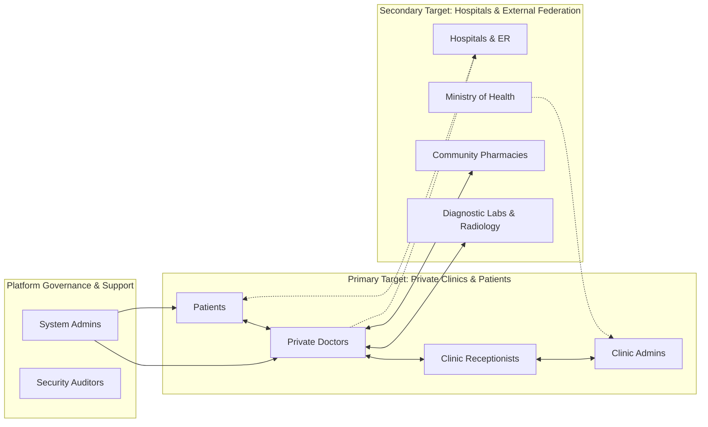

# SEHATI (صِحّتي) — UNIFIED HEALTHCARE MANAGEMENT & MEDICAL RECORDS PLATFORM
## Comprehensive Project Documentation & Technical Specification
**Platform Identity:** Sehati Platform (`ملفك الطبي في مكان واحد`)  
**Core Value Proposition:** *"One Patient, One Medical History, Better Healthcare."*  
**Document Version:** 1.0.0 (Comprehensive Release)  
**Target Environments:** Web Application, Clinic Portal, Doctor Workspace, Patient Mobile & Web Suite  
**Document Modules Included:** Project Planning, Stakeholder Analysis, Database Design & ERD, UI/UX Design System  

---

## Table of Contents
1. [Executive Summary & System Overview](#1-executive-summary--system-overview)
   - 1.1 The Healthcare Challenge
   - 1.2 The Sehati Solution
   - 1.3 Target Market Strategy: Primary (Private Clinics) vs. Secondary (Hospitals)
2. [Section 1: Project Planning](#2-section-1-project-planning)
   - 2.1 Project Vision & Objectives (SMART)
   - 2.2 Scope Management (In-Scope vs. Out-of-Scope)
   - 2.3 Work Breakdown Structure (WBS)
   - 2.4 Phased Implementation Roadmap & Sprints
   - 2.5 Resource Allocation & Team Structure
   - 2.6 Comprehensive Risk Assessment & Mitigation Matrix
   - 2.7 Budget, Funding & Financial Feasibility
   - 2.8 Project Governance, KPIs & Quality Assurance
3. [Section 2: Stakeholder Analysis](#3-section-2-stakeholder-analysis)
   - 3.1 Stakeholder Identification & Categorization
   - 3.2 Power vs. Interest Grid (Mendelow's Matrix)
   - 3.3 Detailed Stakeholder Persona & Profiles
   - 3.4 Stakeholder Needs, Pain Points & Value Proposition Mapping
   - 3.5 RACI Responsibility Assignment Matrix
   - 3.6 Change Management & Healthcare Provider Adoption Strategy
   - 3.7 Legal, Privacy & Compliance Architecture (Egyptian Law 151 & HIPAA Alignment)
4. [Section 3: Database Design & Architecture](#4-section-3-database-design--architecture)
   - 4.1 Architectural Strategy & Design Principles
   - 4.2 Comprehensive Mermaid Entity-Relationship Diagram (ERD)
   - 4.3 Detailed Data Dictionary (All 23 Entities with Constraints & Types)
   - 4.4 Unified Patient ID Format & Generation Logic
   - 4.5 Indexing, Performance & Optimization Strategy
   - 4.6 Security, Audit Trails & Role-Based Access Control (RBAC) Matrix
5. [Section 4: UI/UX Design System & Experience Design](#5-section-4-uiux-design-system--experience-design)
   - 5.1 Design Philosophy: The MedicPro Aesthetic
   - 5.2 Color Tokens & Semantic System
   - 5.3 Typography Hierarchy & Multilingual Scaling
   - 5.4 Component Design Library
   - 5.5 User Personas & Context Scenarios
   - 5.6 Information Architecture & Navigation Hierarchy
   - 5.7 End-to-End User Interaction Workflows
   - 5.8 Accessibility (WCAG 2.1 AA) & Ergonomic Clinical Considerations
6. [Section 5: Project Conclusion & Forward Roadmap](#6-section-5-project-conclusion--forward-roadmap)

---

## 1. Executive Summary & System Overview

### 1.1 The Healthcare Challenge
In modern healthcare systems across Egypt and the broader MENA region, patient medical data remains critically fragmented. A single patient frequently consults multiple doctors across independent private clinics, hospitals, diagnostic labs, and radiology centers. In current practice:
- Medical history is trapped in disconnected physical paper files or isolated local software databases.
- Diagnostic lab results and scans are duplicated unnecessarily, causing physical strain and massive financial waste.
- Emergency room physicians lack instant access to critical vital data, drug allergies, and current medication regimens.
- Doctors make clinical decisions based on incomplete, verbal patient recollections, elevating medical error risks.

### 1.2 The Sehati Solution
**Sehati** is a centralized, digital health record and clinic management platform built to unify every patient's lifelong health journey under a single, lifetime identifier: the **Unified Patient ID (`SH-YYYY-XXXXXX`)**.

Sehati bridges the communication divide between private healthcare providers and empowers patients with absolute sovereignty over their medical information. Through granular consent controls, patients grant authorized physicians temporary or longitudinal access to diagnostic histories, previous clinical notes, prescription archives, and laboratory reports.

```
       +---------------------------------------------------------+
       |               SEHATI UNIFIED CORE ENGINE                |
       +---------------------------------------------------------+
         /                     |                     \
        v                      v                      v
+------------------+  +-------------------+  +------------------+
|  PATIENT PORTAL  |  |  CLINIC & DOCTOR  |  | DIAGNOSTICS & ER |
| Unified Records  |  |     WORKSPACE     |  | Emergency Profile|
| Consent Sharing  |  | Digital Rx & Notes|  | Lab/Scan Archive |
| Appointments     |  | Queue Management  |  | Vital Allergies  |
+------------------+  +-------------------+  +------------------+
```

### 1.3 Target Market Strategy: Primary (Private Clinics) vs. Secondary (Hospitals)

To maximize clinical adoption speed, minimize organizational friction, and establish an organic patient network, Sehati enforces an explicit **two-tiered market adoption strategy**:

```
+---------------------------------------------------------------------------------------------------+
|                        SEHATI STRATEGIC TARGET MARKET ARCHITECTURE                                |
+---------------------------------------------------------------------------------------------------+
|  [PRIMARY TARGET MARKET] — Core Focus (Immediate MVP & Commercial Rollout)                       |
|  * Private Outpatient Clinics & Polyclinics (Solo practitioners & multi-specialty centers)        |
|  * Specialist Doctors (Requiring rapid <30s EMR lookups & digital prescriptions)                  |
|  * Chronic Care Patients & Families (Seeking lifetime medical record ownership & consent sovereignty)|
+---------------------------------------------------------------------------------------------------+
                                                  |
                                                  v  (Federation & Regional Expansion)
+---------------------------------------------------------------------------------------------------+
|  [SECONDARY TARGET MARKET] — Strategic Federation (Growth, Inpatient Gateways & Governance)       |
|  * Hospitals & Enterprise Medical Centers (HIS/LIS referral gateways, ER triage lookups)        |
|  * Diagnostic Laboratories & Radiology Chains (Direct report & DICOM scan integration)           |
|  * Ministry of Health (MoH) & Regulatory Bodies (National health data coordination & compliance) |
+---------------------------------------------------------------------------------------------------+
```

#### 1. Primary Target: Private Outpatient Clinics & Specialists (Core Market Focus)
- **Market Dynamics:** In Egypt and across the broader MENA region, over 70% of day-to-day outpatient consultations occur in independent private clinics and polyclinics. Despite generating substantial clinical encounters, these clinics operate almost entirely with manual paper files or disconnected local tools.
- **Why Private Clinics Are Our Primary Focus:**
  1. **Agile Procurement & Rapid Onboarding:** Unlike large hospital networks encumbered by lengthy procurement committees, budget cycles, and tender procedures, private clinic owners and specialist doctors make autonomous, immediate adoption decisions.
  2. **High-Speed Consultation Workflows:** Private physicians face intense patient queues and require streamlined, low-friction software. Sehati provides 30-second patient history lookups, pre-populated diagnosis templates, and 2-click digital prescriptions without complex enterprise overhead.
  3. **Direct Patient Network Flywheel:** Every private clinic that adopts Sehati registers dozens of walk-in patients into the universal registry under their Unified Patient ID (`SH-YYYY-XXXXXX`). As patients visit other independent specialists, they bring their Sehati ID, creating powerful organic network expansion.

#### 2. Secondary Target: Hospitals & Enterprise Healthcare Facilities (Strategic Federation)
- **Market Dynamics:** Major tertiary hospitals and multi-building inpatient medical centers already operate legacy Hospital Information Systems (HIS) and Laboratory Information Systems (LIS). Attempting a wholesale replacement of these mission-critical enterprise systems on day one introduces prohibitive friction and high switching resistance.
- **Why Hospitals Are Our Secondary Focus:**
  1. **Complementary Federated Gateway:** Rather than replacing in-patient bed management, operating room scheduling, or hospital ward logistics, Sehati connects to hospitals as an **interoperable federation gateway and referral layer**.
  2. **Emergency Room (ER) Critical Lookups:** Hospitals interface with Sehati's emergency engine to retrieve instant life-saving patient summaries (blood type, critical allergies, chronic conditions, active medications) when an unconscious or trauma patient is admitted.
  3. **Inpatient-Outpatient Continuity:** Regional hospital networks leverage Sehati to push inpatient discharge summaries and laboratory findings back into the patient's lifelong record, while receiving clean digital referrals from the primary network of private clinics.

---

## 2. Section 1: Project Planning

### 2.1 Project Vision & SMART Objectives
The overarching vision of Sehati is to eradicate healthcare data fragmentation, establishing an interconnected health ecosystem where continuous, accurate patient history drives clinical excellence.

| SMART Dimension | Metric & Goal |
| :--- | :--- |
| **Specific** | Deliver a multi-tenant cloud healthcare platform supporting patients, doctors, receptionists, clinic owners, and system administrators with a unified electronic medical record engine. |
| **Measurable** | 100% elimination of duplicate diagnostic testing for onboarded patients; record lookup time under 1.5 seconds; 99.9% uptime. |
| **Achievable** | Build a streamlined web application focused initially on private clinics and outpatient practices before federating into regional hospital networks. |
| **Relevant** | Directly aligns with Egypt’s Digital Transformation Vision 2030 and universal health insurance digitalization mandates. |
| **Time-Bound** | Complete MVP development within 16 weeks, followed by 8 weeks of clinical pilot trials across 20 partner clinics. |

### 2.2 Scope Management

```
+------------------------------------------------------------------------+
|                            IN-SCOPE (MVP)                              |
+------------------------------------------------------------------------+
| * Multi-role Authentication (Patient, Doctor, Receptionist, Admins)   |
| * Unique Unified Patient ID Engine (SH-YYYY-XXXXXX)                    |
| * Unified Patient Medical Profile (Allergies, Meds, Conditions)        |
| * Emergency Medical Profile (Public/QR-accessible under security rules)|
| * Clinical Encounters (Chief complaint, Diagnosis, Clinical notes)    |
| * Digital Prescription Builder & Normalized Item Architecture          |
| * Laboratory & Imaging Report Storage (PDF/Image attachment & metadata)|
| * Granular Consent & Sharing Permissions (View Only vs View + Add)     |
| * Clinic Queue Management & Appointment Scheduling                     |
| * Comprehensive Audit Logging for all Medical Data Access Events       |
+------------------------------------------------------------------------+
                                    |
                                    v
+------------------------------------------------------------------------+
|                     OUT-OF-SCOPE (FUTURE RELEASES)                     |
+------------------------------------------------------------------------+
| * Direct Insurance Claims Submission & Automated Clearinghouse         |
| * In-app Telemedicine Video Streaming (Planned Phase 2)                |
| * In-patient Hospital Bed & Ward Management (HIS/LIS Enterprise)      |
| * AI Clinical Decision Support System & Drug-Drug Interaction Warnings |
+------------------------------------------------------------------------+
```

### 2.3 Work Breakdown Structure (WBS)
The project is decomposed into five primary functional workstreams:

```mermaid
graph TD
    Root["1.0 Sehati Platform Development"]
    
    WBS1["1.1 Architecture & Core Foundation"]
    WBS2["1.2 Clinical & Clinic Modules"]
    WBS3["1.3 Patient Portal & Consent Engine"]
    WBS4["1.4 Security, RBAC & Audit Trails"]
    WBS5["1.5 Quality, Pilot & Deployment"]
    
    Root --> WBS1
    Root --> WBS2
    Root --> WBS3
    Root --> WBS4
    Root --> WBS5
    
    WBS1 --> WBS11["1.1.1 Database Schema & ORM Setup"]
    WBS1 --> WBS12["1.1.2 Auth & JWT Session Service"]
    WBS1 --> WBS13["1.1.3 Unified ID Generator Engine"]
    
    WBS2 --> WBS21["1.2.1 Clinic Onboarding & Staff Mgmt"]
    WBS2 --> WBS22["1.2.2 Reception Queue & Check-In"]
    WBS2 --> WBS23["1.2.3 Doctor Consultation & Notes"]
    WBS2 --> WBS24["1.2.4 Digital Prescription System"]
    
    WBS3 --> WBS31["1.3.1 Unified Profile & Medical History"]
    WBS3 --> WBS32["1.3.2 Emergency Profile System"]
    WBS3 --> WBS33["1.3.3 Permission Request & Approval Flow"]
    
    WBS4 --> WBS41["1.4.1 Role-Based Access Control"]
    WBS4 --> WBS42["1.4.2 Immutable Audit Logging Engine"]
    WBS4 --> WBS43["1.4.3 Data Encryption at Rest/Transit"]
    
    WBS5 --> WBS51["1.5.1 End-to-End System Testing"]
    WBS5 --> WBS52["1.5.2 Clinical Pilot in 20 Clinics"]
    WBS5 --> WBS53["1.5.3 Cloud Production Deployment"]
```



### 2.4 Phased Implementation Roadmap & Sprints
The project operates under a bi-weekly Agile/Scrum cycle spanning 24 weeks from inception to commercial pilot.

| Sprint / Phase | Duration | Core Deliverables & Milestones | Exit Criteria |
| :--- | :--- | :--- | :--- |
| **Phase 1: Foundation (Weeks 1–4)** | 4 Weeks | Project setup, schema migration, RBAC models, Unified ID generator, JWT Auth with phone verification. | Core database deployed; Auth passes 100% unit tests. |
| **Phase 2: Clinic & Doctor Workspace (Weeks 5–10)** | 6 Weeks | Clinic Admin dashboard, Doctor profiles, Receptionist queue, Patient check-in, Consultation encounter notes, Prescription builder. | Doctor can record a visit, diagnosis, and prescription in < 2 mins. |
| **Phase 3: Patient Portal & Sharing Engine (Weeks 11–14)** | 4 Weeks | Patient mobile-first web app, Emergency card, Consent management (Grant/Revoke access), Diagnostic uploads. | Patient can view records and grant access to a new clinic via SMS/ID. |
| **Phase 4: Security, Audit & Integration (Weeks 15–18)** | 4 Weeks | Full immutable audit logging, access expiry jobs, PDF prescription generation, notification dispatch (SMS/Email/In-App). | Penetration testing passed; zero critical security vulnerabilities. |
| **Phase 5: Pilot & Validation (Weeks 19–24)** | 6 Weeks | 20 private clinic pilot rollout, user training, feedback integration, performance tuning. | 500+ active patients registered; 95% doctor satisfaction rating. |

### 2.5 Resource Allocation & Team Structure
The project team comprises dedicated cross-functional engineering and domain roles:

| Team Member | Primary Role | Core Responsibilities |
| :--- | :--- | :--- |
| **Shahd Bahaa** | Product Manager & Lead Systems Analyst | Functional specifications, stakeholder alignment, user story prioritization, clinical requirement validation. |
| **Fathy Ayman** | Lead Software Architect & Backend Engineer | System architecture, relational database design, core APIs, concurrency control, Unified ID generator engine. |
| **Mina Ekram** | Security, DevOps & Database Engineer | RBAC implementation, data encryption, audit log subsystem, automated CI/CD pipelines, cloud deployment. |
| **Ereny Atef** | Lead UI/UX Designer & Frontend Engineer | Design system creation (MedicPro aesthetic), responsive component library, patient and clinic portal frontend development. |
| **Khaled Abdel fattah** | Full-Stack Engineer & QA Integration Lead | Doctor encounter flows, digital prescription module, end-to-end integration testing, clinic pilot training and support. |

### 2.6 Comprehensive Risk Assessment & Mitigation Matrix

```
       LIKELIHOOD
         ^
    HIGH |   [R-02] Adoption Friction       |   [R-01] Data Breach & Privacy
         |                                  |
     MED |   [R-04] Duplicate Profiles      |   [R-03] Clinic Network Downtime
         |                                  |
     LOW |   [R-06] Incomplete Paper Mig.   |   [R-05] Regulatory Policy Shift
         +--------------------------------------------------------------------> IMPACT
                        LOW / MED                           HIGH / CRITICAL
```

| Risk ID | Description | Impact | Likelihood | Mitigation Strategy |
| :--- | :--- | :--- | :--- | :--- |
| **R-01** | Unauthorized disclosure or breach of sensitive medical records. | **Critical** | Low | Implement AES-256 field encryption for sensitive clinical notes; Zero-Trust RBAC; immutable audit logging for every read/write event; mandatory multi-factor auth. |
| **R-02** | Resistance from private clinic doctors to adopt digital data entry during busy clinics. | **High** | High | Design high-speed UX: pre-populated diagnosis templates, rapid autocomplete for medications, voice-to-text dictation support, one-click past history summary. |
| **R-03** | Clinic Internet outage preventing receptionists from verifying patients. | **High** | Medium | Implement local PWA caching of current day’s appointment queue with automatic cryptographic sync upon reconnection. |
| **R-04** | Patient duplicate profile creation when phone numbers change. | **Medium** | Medium | Rigorous identity matching algorithm (National ID hash + Birth Date + Full Name fuzzy match) flagging potential duplicates for admin review before creation. |
| **R-05** | Changes in Egyptian Health Data Regulations. | **High** | Low | Modular compliance architecture separating localized data storage endpoints from application logic to ensure immediate adaptability. |
| **R-06** | Patient data entry errors when uploading historical lab results. | **Medium** | Low | Receptionist and doctor review verification step before lab entries are permanently tagged as "Clinically Verified". |

### 2.7 Budget, Funding & Financial Feasibility
Sehati employs a sustainable multi-tier growth and funding model:

1. **Bootstrapping (MVP Stage):**
   - Core team sweat equity, open-source stack, and low-cost serverless cloud infrastructure on managed PostgreSQL and edge containers.
2. **Strategic Healthcare Partnerships:**
   - Collaborating with private clinic networks, diagnostic lab chains, and the Egyptian Ministry of Health to pilot digital patient record integration.
3. **Government Grants & Startup Competitions:**
   - Targeting initiatives supported by Egypt's Ministry of Communications and Information Technology (MCIT), ITIDA, and health-tech innovation accelerators.
4. **B2B SaaS Revenue Model:**
   - **Free Tier for Patients:** Free lifetime unified medical record, emergency card, and consent portal.
   - **Clinic Subscription Tier (Primary Revenue Engine):** Monthly subscription per clinic ($25 – $60/month) covering doctor scheduling, queue management, digital prescriptions, and multi-branch synchronization.
   - **Hospital & Enterprise Federation Tier (Secondary Expansion):** Federated API licensing, ER emergency lookup integration, and inter-facility outpatient referral management for hospital polyclinics and regional health networks.

---

## 3. Section 2: Stakeholder Analysis

### 3.1 Stakeholder Identification & Categorization (Primary vs. Secondary Market Focus)
Healthcare ecosystems have diverse, interdependent stakeholders with contrasting motivations. To maintain operational focus, Sehati categorizes stakeholders into **Primary Market Targets** (immediate core MVP) and **Secondary Market Targets** (federation & ecosystem scale):

| Market Tier | Stakeholder Group | Core Role in Sehati Ecosystem |
| :--- | :--- | :--- |
| **Primary Target (Core Focus)** | **Private Clinic Owners & Admins** | Decision-makers purchasing subscriptions; manage multi-room clinic operations, doctor rosters, and staff. |
| **Primary Target (Core Focus)** | **Private Specialist Doctors** | Primary clinical users; record fast encounter notes, issue digital prescriptions, and review longitudinal history. |
| **Primary Target (Core Focus)** | **Clinic Receptionists** | Front-desk operators managing daily walk-in queues, patient check-in, and onboarding with the Unified Patient ID. |
| **Primary Target (Core Focus)** | **Patients & Chronic Care Individuals** | Sovereign record owners; grant/revoke doctor consent and access emergency cards on mobile devices. |
| **Secondary Target (Federation)** | **Hospitals & Polyclinic Networks** | Regional hospital facilities using Sehati as a federated referral layer and ER vital triage lookup engine. |
| **Secondary Target (Federation)** | **Diagnostic Labs & Radiology Centers** | External diagnostic providers uploading verified blood work, pathology reports, and radiological scans directly. |
| **Secondary Target (Federation)** | **Ministry of Health (MoH) & Regulators** | Governance authorities ensuring adherence to Egyptian Data Protection Law 151 and universal insurance alignment. |



### 3.2 Power vs. Interest Grid (Mendelow's Matrix)

| Category | Stakeholders | Management Strategy |
| :--- | :--- | :--- |
| **High Power, High Interest (Key Players)** | • Private Clinic Administrators & Owners<br>• Lead Medical Doctors<br>• Ministry of Health / Regulators | **Manage Closely:** Involve directly in design reviews, ensure rapid workflow compliance, address operational pain points first. |
| **High Power, Low Interest (Keep Satisfied)** | • Hospital Enterprise Directors (Federation Partners)<br>• Healthcare Data Protection Authorities<br>• Medical Syndicates | **Keep Satisfied:** Guarantee rigorous adherence to legal standards, seamless non-disruptive API federation, and patient privacy safeguards. |
| **Low Power, High Interest (Keep Informed)** | • Patients & Chronic Care Individuals<br>• Clinic Receptionists | **Keep Informed & Empower:** Provide intuitive interfaces, fast check-in speeds, clear consent controls, and mobile accessibility. |
| **Low Power, Low Interest (Monitor)** | • Generic Technology Vendors<br>• Third-Party Medical Device Resellers | **Monitor:** Keep updated via automated API specs and release notes with minimal overhead. |

### 3.3 Detailed Stakeholder Profiles & Personas

#### Persona 1: The Patient (Sarah Hassan, 46)
- **Background:** Diagnosed with Type 2 Diabetes and Hypertension; visits an endocrinologist in Mohandessin and a cardiologist in Heliopolis.
- **Goals:** Avoid carrying bulky folders of lab tests and echocardiograms to every appointment; ensure doctors don't prescribe conflicting medications.
- **Pain Points:** Repeated blood tests cost money; cannot remember specific dosages prescribed 6 months ago.
- **Sehati Value:** One unified ID (`SH-2026-004812`), full prescription timeline on her phone, instant emergency card.

#### Persona 2: The Specialist Doctor (Dr. Tarek El-Masry, 52)
- **Background:** Senior Consultant Internist running private clinics in two different medical centers.
- **Goals:** Get a reliable 30-second summary of a new patient’s history, allergies, and current medications before writing a new diagnosis.
- **Pain Points:** Spends 10 minutes of consultation time interrogating patients on what previous doctors gave them; illegible handwriting on old paper prescriptions.
- **Sehati Value:** Authorized access to chronological visits, verified digital lab results, one-click digital prescription generation.

#### Persona 3: The Clinic Receptionist (Mariam Adel, 27)
- **Background:** Front-desk manager handling 60+ patient walk-ins and phone calls per shift across 4 clinic doctors.
- **Goals:** Check patients in under 30 seconds; manage daily queue order without arguments or chaotic paper tokens.
- **Pain Points:** Patients forget their national ID or clinic file number; doctors get angry when files go missing.
- **Sehati Value:** Instant lookup by phone number or Unified ID; automated queue status; zero paper folder handling.

### 3.4 Stakeholder Needs & Value Proposition Mapping

| Stakeholder Group | Primary Needs | Key Pain Points Addressed | Sehati Core Feature |
| :--- | :--- | :--- | :--- |
| **Patients** | Safety, convenience, ownership of health records. | Lost paper reports, duplicate test bills, forgotten drug names. | Unified Patient ID, Consent Manager, Emergency Profile. |
| **Doctors** | Clinical efficiency, fast decision-making, patient safety. | Missing medical records, drug interactions, consultation delays. | Digital Encounters, Chronic Condition Tracker, Digital Rx. |
| **Receptionists** | Rapid patient check-in, smooth queue coordination. | Waiting room chaos, missing paper files, booking mistakes. | Search by Phone/ID, Real-time Queue Dashboard. |
| **Clinic Owners** | Operational efficiency, staff accountability, clinic growth. | Revenue leakage, lack of activity visibility, doctor turnover. | Clinic Performance Analytics, Role-based Staff Control. |
| **Ministry of Health** | Population health visibility, healthcare digitalization. | Fragmented health data, poor emergency response records. | Standardized data architecture, API-ready integration. |

### 3.5 RACI Responsibility Assignment Matrix

| System Workflow / Activity | Patient | Doctor | Receptionist | Clinic Admin | System Admin |
| :--- | :---: | :---: | :---: | :---: | :---: |
| **Patient Registration & Unified ID Creation** | **A / R** | I | **R** | I | C |
| **Clinic Staff & Doctor Account Provisioning** | I | I | I | **A / R** | C |
| **Emergency Profile Maintenance** | **A / R** | C | I | I | I |
| **Granting / Revoking Medical Access Permission** | **A / R** | C | I | I | I |
| **Patient Check-in & Queue Sequencing** | I | I | **A / R** | I | I |
| **Clinical Consultation, Diagnosis & Notes** | I | **A / R** | I | I | I |
| **Creating & Authorizing Digital Prescription** | I | **A / R** | I | I | I |
| **Uploading Lab & Diagnostic Radiology Reports** | C | **A / R** | R | I | I |
| **System-wide Security Audit Log Review** | I | I | I | C | **A / R** |

*Legend: **R** = Responsible, **A** = Accountable, **C** = Consulted, **I** = Informed.*

### 3.6 Change Management & Healthcare Provider Adoption Strategy
The greatest failure mode for healthcare software is user friction. Sehati overcomes adoption hurdles through:
1. **The "Zero-Disruption" Consultation Flow:** A physician can complete a routine encounter in under 3 clicks using preset diagnostic templates and rapid auto-completing medication libraries.
2. **Offline-Resilient Reception Mode:** Even during sporadic connectivity drops, reception staff can queue and register patients locally.
3. **Patient Mobile Empowerment without App Store Mandates:** Patients can access their profile, emergency card, and permissions via mobile web browser with SMS-based magic link authentication, eliminating download friction for elderly or non-tech-savvy users.

### 3.7 Legal, Privacy & Compliance Architecture
Sehati is engineered from the ground up to comply with **Egyptian Data Protection Law No. 151 of 2020** and international healthcare confidentiality standards (HIPAA Security Rule):
- **Explicit Consent Mandate:** No physician or clinic can view a patient's historical medical records without explicit, logged patient consent.
- **Emergency Exception Protocol:** In life-threatening emergencies, designated medical personnel can access a stripped-down `EmergencyProfile` (Allergies, Blood Type, Emergency Contacts, Chronic Conditions) via a secure, logged emergency override that immediately notifies the patient and generates an immutable audit alert.
- **Data Minimization:** Receptionists see only administrative scheduling data; clinical notes and diagnoses are strictly cryptographically segregated.

---

## 4. Section 3: Database Design & Architecture

### 4.1 Architectural Strategy & Design Principles
The Sehati database architecture is designed with high normalization (3NF), strict foreign key referential integrity, and complete audit trace logging.
- **Multi-Tenancy with Unified Centrality:** Clinics operate as autonomous tenants with their own staff, hours, and appointments, but converge on a single universal `Patients` and `MedicalRecords` registry.
- **Separation of Prescription Header & Line Items:** A prescription acts as an authorized medical instrument linked to multiple granular medication items with independent dosages and instructions.
- **Many-to-Many Doctor-Clinic Affiliation:** Doctors can practice across multiple independent clinics with separate working hours and statuses via the `ClinicDoctors` junction entity.

### 4.2 Comprehensive Mermaid Entity-Relationship Diagram (ERD)

```mermaid
erDiagram
    USERS ||--o{ ROLES : "has"
    USERS ||--o| PATIENTS : "authenticates"
    USERS ||--o| DOCTORS : "authenticates"
    USERS ||--o| RECEPTIONISTS : "authenticates"
    USERS ||--o{ NOTIFICATIONS : "receives"
    USERS ||--o{ AUDIT_LOGS : "triggers"

    CLINICS ||--o{ CLINIC_DOCTORS : "employs"
    DOCTORS ||--o{ CLINIC_DOCTORS : "practices_at"
    CLINICS ||--o{ RECEPTIONISTS : "employs"
    CLINICS ||--o{ VISITS : "hosts"
    CLINICS ||--o{ APPOINTMENTS : "schedules"
    CLINICS ||--o{ ACCESS_PERMISSIONS : "granted_to"

    PATIENTS ||--|| MEDICAL_RECORDS : "owns"
    PATIENTS ||--o| EMERGENCY_PROFILES : "maintains"
    PATIENTS ||--o{ VISITS : "undergoes"
    PATIENTS ||--o{ APPOINTMENTS : "books"
    PATIENTS ||--o{ FOLLOW_UPS : "assigned"
    PATIENTS ||--o{ ACCESS_PERMISSIONS : "authorizes"
    PATIENTS ||--o{ ALLERGIES : "experiences"
    PATIENTS ||--o{ MEDICATIONS : "takes"
    PATIENTS ||--o{ TESTS : "has"
    PATIENTS ||--o{ SCANS : "has"
    PATIENTS ||--o{ PRESCRIPTIONS : "receives"
    PATIENTS ||--o{ AUDIT_LOGS : "subject_of"

    DOCTORS ||--o{ VISITS : "conducts"
    DOCTORS ||--o{ PRESCRIPTIONS : "authorizes"
    DOCTORS ||--o{ APPOINTMENTS : "attends"
    DOCTORS ||--o{ FOLLOW_UPS : "schedules"
    DOCTORS ||--o{ ACCESS_PERMISSIONS : "granted_to"

    VISITS ||--o{ DIAGNOSES : "yields"
    VISITS ||--o{ TREATMENTS : "prescribes"
    VISITS ||--o{ PRESCRIPTIONS : "issues"
    VISITS ||--o{ TESTS : "orders"
    VISITS ||--o{ SCANS : "orders"
    VISITS ||--o{ FOLLOW_UPS : "initiates"

    PRESCRIPTIONS ||--|{ PRESCRIPTION_ITEMS : "contains"

    USERS {
        int UserId PK
        string Email UK
        string PasswordHash
        string Phone UK
        int RoleId FK
        bool IsActive
        datetime CreatedAt
    }

    ROLES {
        int RoleId PK
        string RoleName UK
    }

    PATIENTS {
        int PatientId PK
        int UserId FK
        string UnifiedPatientId UK
        string FullName
        date DateOfBirth
        string Gender
        string Address
        string EmergencyContact
        datetime CreatedAt
    }

    CLINICS {
        int ClinicId PK
        string ClinicName
        string Specialty
        string Address
        string Phone
        string Email
        string WorkingHours
        string Status
        datetime CreatedAt
    }

    DOCTORS {
        int DoctorId PK
        int UserId FK
        string FullName
        string Specialty
        string LicenseNumber UK
        string Phone
        string Email
    }

    CLINIC_DOCTORS {
        int ClinicDoctorId PK
        int ClinicId FK
        int DoctorId FK
        datetime JoinedAt
        string Status
    }

    RECEPTIONISTS {
        int ReceptionistId PK
        int UserId FK
        int ClinicId FK
        string FullName
    }

    MEDICAL_RECORDS {
        int MedicalRecordId PK
        int PatientId FK,UK
        datetime CreatedAt
        datetime LastUpdatedAt
    }

    VISITS {
        int VisitId PK
        int PatientId FK
        int DoctorId FK
        int ClinicId FK
        datetime VisitDate
        string ChiefComplaint
        string Notes
        string Status
    }

    DIAGNOSES {
        int DiagnosisId PK
        int VisitId FK
        string DiagnosisName
        string Description
        datetime DiagnosisDate
    }

    TREATMENTS {
        int TreatmentId PK
        int VisitId FK
        string TreatmentDescription
        date StartDate
        date EndDate
        string Instructions
    }

    PRESCRIPTIONS {
        int PrescriptionId PK
        int VisitId FK
        int DoctorId FK
        int PatientId FK
        datetime PrescriptionDate
        string Notes
    }

    PRESCRIPTION_ITEMS {
        int PrescriptionItemId PK
        int PrescriptionId FK
        string MedicationName
        string Dosage
        string Frequency
        string Duration
        string Instructions
    }

    ALLERGIES {
        int AllergyId PK
        int PatientId FK
        string AllergyName
        string Reaction
        string Notes
    }

    MEDICATIONS {
        int MedicationId PK
        int PatientId FK
        string MedicationName
        string Dosage
        string Frequency
        date StartDate
        date EndDate
        string Notes
    }

    TESTS {
        int TestId PK
        int PatientId FK
        int VisitId FK
        string TestName
        date TestDate
        string Result
        string Notes
        string FileUrl
    }

    SCANS {
        int ScanId PK
        int PatientId FK
        int VisitId FK
        string ScanType
        date ScanDate
        string Result
        string FileUrl
        string Notes
    }

    APPOINTMENTS {
        int AppointmentId PK
        int PatientId FK
        int DoctorId FK
        int ClinicId FK
        date AppointmentDate
        time StartTime
        time EndTime
        string Status
        string Notes
    }

    FOLLOW_UPS {
        int FollowUpId PK
        int PatientId FK
        int DoctorId FK
        int VisitId FK
        date FollowUpDate
        string Notes
        string Status
    }

    EMERGENCY_PROFILES {
        int EmergencyProfileId PK
        int PatientId FK,UK
        string BloodType
        string EmergencyNotes
        string EmergencyContactName
        string EmergencyContactPhone
        datetime LastUpdatedAt
    }

    ACCESS_PERMISSIONS {
        int AccessPermissionId PK
        int PatientId FK
        int DoctorId FK
        int ClinicId FK
        string AccessType
        datetime GrantedAt
        datetime ExpiresAt
        string Status
    }

    NOTIFICATIONS {
        int NotificationId PK
        int UserId FK
        string Title
        string Message
        string Type
        bool IsRead
        datetime CreatedAt
    }

    AUDIT_LOGS {
        int AuditLogId PK
        int UserId FK
        int PatientId FK
        string Action
        string EntityName
        int EntityId
        datetime Timestamp
        string IPAddress
    }
```



### 4.3 Detailed Data Dictionary (All 23 Entities)

#### 1. `Users`
*Stores system-wide authentication credentials and primary login identity.*
- `UserId`: INT, Primary Key, Auto-Increment.
- `Email`: VARCHAR(150), Unique, Not Null.
- `PasswordHash`: VARCHAR(255), Not Null. (bcrypt salted hash).
- `Phone`: VARCHAR(20), Unique, Not Null. E.164 international format.
- `RoleId`: INT, Foreign Key -> `Roles(RoleId)`, Not Null.
- `IsActive`: BOOLEAN, Default TRUE. Used for account suspension.
- `CreatedAt`: TIMESTAMP, Default `CURRENT_TIMESTAMP`.

#### 2. `Roles`
*Defines access tiers for the Role-Based Access Control (RBAC) engine.*
- `RoleId`: INT, Primary Key, Auto-Increment.
- `RoleName`: VARCHAR(50), Unique, Not Null. `('Patient', 'Doctor', 'Receptionist', 'ClinicAdmin', 'SystemAdmin')`.

#### 3. `Patients`
*Stores demographic, identification, and unified patient core data.*
- `PatientId`: INT, Primary Key, Auto-Increment.
- `UserId`: INT, Foreign Key -> `Users(UserId)`, Unique, Not Null.
- `UnifiedPatientId`: VARCHAR(30), Unique, Not Null. Format: `SH-YYYY-XXXXXX`.
- `FullName`: VARCHAR(150), Not Null.
- `DateOfBirth`: DATE, Not Null.
- `Gender`: ENUM('Male', 'Female'), Not Null.
- `Address`: VARCHAR(255), Nullable.
- `EmergencyContact`: VARCHAR(100), Nullable.
- `CreatedAt`: TIMESTAMP, Default `CURRENT_TIMESTAMP`.

#### 4. `Clinics`
*Represents private clinics, group practices, or healthcare centers.*
- `ClinicId`: INT, Primary Key, Auto-Increment.
- `ClinicName`: VARCHAR(150), Not Null.
- `Specialty`: VARCHAR(100), Not Null (e.g., Cardiology, Pediatrics, Polyclinic).
- `Address`: VARCHAR(255), Not Null.
- `Phone`: VARCHAR(30), Not Null.
- `Email`: VARCHAR(150), Not Null.
- `WorkingHours`: VARCHAR(255), Not Null (e.g., 'Sun-Thu 09:00-21:00').
- `Status`: ENUM('Pending', 'Active', 'Suspended'), Default 'Pending'.
- `CreatedAt`: TIMESTAMP, Default `CURRENT_TIMESTAMP`.

#### 5. `Doctors`
*Maintains professional profiles, credentials, and medical licenses of doctors.*
- `DoctorId`: INT, Primary Key, Auto-Increment.
- `UserId`: INT, Foreign Key -> `Users(UserId)`, Unique, Not Null.
- `FullName`: VARCHAR(150), Not Null.
- `Specialty`: VARCHAR(100), Not Null.
- `LicenseNumber`: VARCHAR(100), Unique, Not Null. Verified against medical syndicate records.
- `Phone`: VARCHAR(30), Not Null.
- `Email`: VARCHAR(150), Not Null.

#### 6. `ClinicDoctors`
*Manages many-to-many affiliations between doctors and practicing clinics.*
- `ClinicDoctorId`: INT, Primary Key, Auto-Increment.
- `ClinicId`: INT, Foreign Key -> `Clinics(ClinicId)`, Not Null.
- `DoctorId`: INT, Foreign Key -> `Doctors(DoctorId)`, Not Null.
- `JoinedAt`: TIMESTAMP, Default `CURRENT_TIMESTAMP`.
- `Status`: ENUM('Pending', 'Active', 'Suspended'), Default 'Active'.
- *Unique Constraint:* `(ClinicId, DoctorId)` ensures no duplicate associations.

#### 7. `Receptionists`
*Maintains clinic front-desk personnel information.*
- `ReceptionistId`: INT, Primary Key, Auto-Increment.
- `UserId`: INT, Foreign Key -> `Users(UserId)`, Unique, Not Null.
- `ClinicId`: INT, Foreign Key -> `Clinics(ClinicId)`, Not Null.
- `FullName`: VARCHAR(150), Not Null.

#### 8. `MedicalRecords`
*Anchor record linking a patient to their unified longitudinal medical history.*
- `MedicalRecordId`: INT, Primary Key, Auto-Increment.
- `PatientId`: INT, Foreign Key -> `Patients(PatientId)`, Unique, Not Null. (1-to-1).
- `CreatedAt`: TIMESTAMP, Default `CURRENT_TIMESTAMP`.
- `LastUpdatedAt`: TIMESTAMP, Default `CURRENT_TIMESTAMP ON UPDATE CURRENT_TIMESTAMP`.

#### 9. `Visits`
*Records each clinical encounter between a patient, doctor, and clinic.*
- `VisitId`: INT, Primary Key, Auto-Increment.
- `PatientId`: INT, Foreign Key -> `Patients(PatientId)`, Not Null.
- `DoctorId`: INT, Foreign Key -> `Doctors(DoctorId)`, Not Null.
- `ClinicId`: INT, Foreign Key -> `Clinics(ClinicId)`, Not Null.
- `VisitDate`: TIMESTAMP, Default `CURRENT_TIMESTAMP`.
- `ChiefComplaint`: TEXT, Not Null.
- `Notes`: TEXT, Nullable.
- `Status`: ENUM('CheckedIn', 'InConsultation', 'Completed', 'Cancelled'), Default 'Completed'.

#### 10. `Diagnoses`
*Clinical conditions identified during a medical encounter.*
- `DiagnosisId`: INT, Primary Key, Auto-Increment.
- `VisitId`: INT, Foreign Key -> `Visits(VisitId)`, Not Null.
- `DiagnosisName`: VARCHAR(200), Not Null. (ICD-10 compatible string).
- `Description`: TEXT, Nullable.
- `DiagnosisDate`: TIMESTAMP, Default `CURRENT_TIMESTAMP`.

#### 11. `Treatments`
*Therapeutic management plans formulated during an encounter.*
- `TreatmentId`: INT, Primary Key, Auto-Increment.
- `VisitId`: INT, Foreign Key -> `Visits(VisitId)`, Not Null.
- `TreatmentDescription`: TEXT, Not Null.
- `StartDate`: DATE, Not Null.
- `EndDate`: DATE, Nullable.
- `Instructions`: TEXT, Nullable.

#### 12. `Prescriptions`
*Digital prescription header recording authoring physician and consultation date.*
- `PrescriptionId`: INT, Primary Key, Auto-Increment.
- `VisitId`: INT, Foreign Key -> `Visits(VisitId)`, Not Null.
- `DoctorId`: INT, Foreign Key -> `Doctors(DoctorId)`, Not Null.
- `PatientId`: INT, Foreign Key -> `Patients(PatientId)`, Not Null.
- `PrescriptionDate`: TIMESTAMP, Default `CURRENT_TIMESTAMP`.
- `Notes`: TEXT, Nullable.

#### 13. `PrescriptionItems`
*Individual pharmacological line-items attached to an authorized prescription.*
- `PrescriptionItemId`: INT, Primary Key, Auto-Increment.
- `PrescriptionId`: INT, Foreign Key -> `Prescriptions(PrescriptionId)`, Not Null.
- `MedicationName`: VARCHAR(200), Not Null.
- `Dosage`: VARCHAR(100), Not Null (e.g., '500mg', '10ml').
- `Frequency`: VARCHAR(100), Not Null (e.g., 'Twice daily after meals').
- `Duration`: VARCHAR(100), Not Null (e.g., '7 days', 'Ongoing').
- `Instructions`: TEXT, Nullable.

#### 14. `Allergies`
*Documented adverse drug and food reactions critical for clinical safety.*
- `AllergyId`: INT, Primary Key, Auto-Increment.
- `PatientId`: INT, Foreign Key -> `Patients(PatientId)`, Not Null.
- `AllergyName`: VARCHAR(150), Not Null (e.g., Penicillin, Sulfa, Peanuts).
- `Reaction`: VARCHAR(255), Not Null (e.g., Anaphylaxis, Skin rash).
- `Notes`: TEXT, Nullable.

#### 15. `Medications`
*Long-term and chronic medications actively taken by the patient.*
- `MedicationId`: INT, Primary Key, Auto-Increment.
- `PatientId`: INT, Foreign Key -> `Patients(PatientId)`, Not Null.
- `MedicationName`: VARCHAR(200), Not Null.
- `Dosage`: VARCHAR(100), Not Null.
- `Frequency`: VARCHAR(100), Not Null.
- `StartDate`: DATE, Not Null.
- `EndDate`: DATE, Nullable.
- `Notes`: TEXT, Nullable.

#### 16. `Tests`
*Laboratory diagnostic tests, blood panels, and biological assays.*
- `TestId`: INT, Primary Key, Auto-Increment.
- `PatientId`: INT, Foreign Key -> `Patients(PatientId)`, Not Null.
- `VisitId`: INT, Foreign Key -> `Visits(VisitId)`, Nullable.
- `TestName`: VARCHAR(200), Not Null (e.g., HbA1c, CBC, Lipid Profile).
- `TestDate`: DATE, Not Null.
- `Result`: TEXT, Nullable. (Quantitative summary or findings).
- `Notes`: TEXT, Nullable.
- `FileUrl`: VARCHAR(500), Nullable. Secure cloud object URL for PDF report.

#### 17. `Scans`
*Radiological imaging reports (X-Rays, MRIs, CT scans, Ultrasounds).*
- `ScanId`: INT, Primary Key, Auto-Increment.
- `PatientId`: INT, Foreign Key -> `Patients(PatientId)`, Not Null.
- `VisitId`: INT, Foreign Key -> `Visits(VisitId)`, Nullable.
- `ScanType`: VARCHAR(150), Not Null (e.g., 'Chest X-Ray', 'Brain MRI with contrast').
- `ScanDate`: DATE, Not Null.
- `Result`: TEXT, Nullable. (Radiologist impression).
- `FileUrl`: VARCHAR(500), Nullable. High-res scan or DICOM/PDF attachment.
- `Notes`: TEXT, Nullable.

#### 18. `Appointments`
*Scheduling and queue calendar for clinics, patients, and doctors.*
- `AppointmentId`: INT, Primary Key, Auto-Increment.
- `PatientId`: INT, Foreign Key -> `Patients(PatientId)`, Not Null.
- `DoctorId`: INT, Foreign Key -> `Doctors(DoctorId)`, Not Null.
- `ClinicId`: INT, Foreign Key -> `Clinics(ClinicId)`, Not Null.
- `AppointmentDate`: DATE, Not Null.
- `StartTime`: TIME, Not Null.
- `EndTime`: TIME, Not Null.
- `Status`: ENUM('Pending', 'Confirmed', 'Completed', 'Cancelled', 'NoShow'), Default 'Pending'.
- `Notes`: TEXT, Nullable.

#### 19. `FollowUps`
*Scheduled post-consultation reviews and monitoring checkpoints.*
- `FollowUpId`: INT, Primary Key, Auto-Increment.
- `PatientId`: INT, Foreign Key -> `Patients(PatientId)`, Not Null.
- `DoctorId`: INT, Foreign Key -> `Doctors(DoctorId)`, Not Null.
- `VisitId`: INT, Foreign Key -> `Visits(VisitId)`, Not Null.
- `FollowUpDate`: DATE, Not Null.
- `Notes`: TEXT, Nullable.
- `Status`: ENUM('Scheduled', 'Completed', 'Missed', 'Cancelled'), Default 'Scheduled'.

#### 20. `EmergencyProfiles`
*Life-saving emergency data accessible instantly during acute interventions.*
- `EmergencyProfileId`: INT, Primary Key, Auto-Increment.
- `PatientId`: INT, Foreign Key -> `Patients(PatientId)`, Unique, Not Null. (1-to-1).
- `BloodType`: ENUM('A+', 'A-', 'B+', 'B-', 'AB+', 'AB-', 'O+', 'O-', 'Unknown'), Default 'Unknown'.
- `EmergencyNotes`: TEXT, Nullable (e.g., "Pacemaker implanted; Asthmatic").
- `EmergencyContactName`: VARCHAR(150), Not Null.
- `EmergencyContactPhone`: VARCHAR(30), Not Null.
- `LastUpdatedAt`: TIMESTAMP, Default `CURRENT_TIMESTAMP ON UPDATE CURRENT_TIMESTAMP`.

#### 21. `AccessPermissions`
*The patient-driven consent engine controlling access to historical health records.*
- `AccessPermissionId`: INT, Primary Key, Auto-Increment.
- `PatientId`: INT, Foreign Key -> `Patients(PatientId)`, Not Null.
- `DoctorId`: INT, Foreign Key -> `Doctors(DoctorId)`, Nullable.
- `ClinicId`: INT, Foreign Key -> `Clinics(ClinicId)`, Nullable.
- `AccessType`: ENUM('ViewOnly', 'ViewAndAddRecords'), Not Null.
- `GrantedAt`: TIMESTAMP, Default `CURRENT_TIMESTAMP`.
- `ExpiresAt`: TIMESTAMP, Nullable. (e.g., 24 hours, 7 days, or Revoked).
- `Status`: ENUM('Active', 'Expired', 'Revoked'), Default 'Active'.
- *Integrity Rule:* At least one of `DoctorId` or `ClinicId` must be non-null.

#### 22. `Notifications`
*Omnichannel alerts and clinical dispatch updates.*
- `NotificationId`: INT, Primary Key, Auto-Increment.
- `UserId`: INT, Foreign Key -> `Users(UserId)`, Not Null.
- `Title`: VARCHAR(200), Not Null.
- `Message`: TEXT, Not Null.
- `Type`: ENUM('Appointment', 'Prescription', 'MedicalRecord', 'AccessRequest', 'System'), Not Null.
- `IsRead`: BOOLEAN, Default FALSE.
- `CreatedAt`: TIMESTAMP, Default `CURRENT_TIMESTAMP`.

#### 23. `AuditLogs`
*Immutable, cryptographically verifiable log of all sensitive data access.*
- `AuditLogId`: INT, Primary Key, Auto-Increment.
- `UserId`: INT, Foreign Key -> `Users(UserId)`, Not Null (The actor).
- `PatientId`: INT, Foreign Key -> `Patients(PatientId)`, Nullable (The subject).
- `Action`: VARCHAR(100), Not Null (e.g., 'LOGIN', 'VIEW_RECORD', 'ADD_DIAGNOSIS', 'REVOKE_PERMISSION').
- `EntityName`: VARCHAR(100), Not Null (e.g., 'MedicalRecords', 'Prescriptions').
- `EntityId`: INT, Nullable (The specific record ID touched).
- `Timestamp`: TIMESTAMP, Default `CURRENT_TIMESTAMP`.
- `IPAddress`: VARCHAR(45), Not Null. (Supports IPv4 and IPv6).

### 4.4 Unified Patient ID Format & Generation Logic
The **Unified Patient ID** serves as the universal passport across all connected healthcare providers.

$$\text{Format: } \mathbf{SH-YYYY-NNNNNN}$$
- `SH`: System Prefix ("Sehati").
- `YYYY`: Registration Year (e.g., 2026).
- `NNNNNN`: 6-digit zero-padded monotonic sequence seeded with cryptographic entropy to prevent sequential scraping (e.g., `SH-2026-001245`).

**Collision Prevention & Integrity Guarantees:**
1. Database-enforced `UNIQUE` constraint on `Patients(UnifiedPatientId)`.
2. Atomic sequence increment within transactional boundaries.
3. Verification against National ID hash to guarantee that each physical human being receives exactly **one** lifetime Unified Patient ID.

### 4.5 Indexing & Performance Optimization Strategy
To guarantee sub-second queries across millions of healthcare records:
- **Composite Index on Patient Lookup:** `CREATE INDEX idx_patients_search ON Patients(Phone, FullName);`
- **Unique Hash Index:** `CREATE UNIQUE INDEX idx_unified_id ON Patients(UnifiedPatientId);`
- **Clinical Encounter Chronology Index:** `CREATE INDEX idx_visits_patient_date ON Visits(PatientId, VisitDate DESC);`
- **Active Consent Evaluation Index:** `CREATE INDEX idx_permissions_lookup ON AccessPermissions(PatientId, DoctorId, Status, ExpiresAt);`
- **Audit Timestamp Partitioning:** Partitioning `AuditLogs` monthly by `Timestamp` to maintain rapid read/write performance during regulatory reviews.

### 4.6 Role-Based Access Control (RBAC) Permissions Matrix

| Granular Action | Patient | Doctor | Receptionist | Clinic Admin | System Admin |
| :--- | :---: | :---: | :---: | :---: | :---: |
| **View Personal Profile** | YES | NO | NO | LIMITED | NO |
| **View Longitudinal Medical History** | Own Record | With Consent | NO | LIMITED | NO (Privacy Wall) |
| **Record Clinical Diagnosis & Notes** | NO | YES | NO | NO | NO |
| **Author Digital Prescription** | NO | YES | NO | NO | NO |
| **Upload Lab & Radiology Scans** | YES | YES | NO | NO | NO |
| **Manage Clinic Appointments & Queue** | Own Only | Own Calendar | Clinic-wide | Clinic-wide | NO |
| **Provision & Suspend Clinic Staff** | NO | NO | NO | YES | LIMITED |
| **Grant / Revoke Sharing Access** | Own Record | NO | NO | NO | NO |
| **Inspect System Audit Logs** | Own Logs | NO | NO | Clinic Audit | FULL SYSTEM |

---

## 5. Section 4: UI/UX Design System & Experience Design

### 5.1 Design Philosophy: The MedicPro Aesthetic
The visual identity of Sehati is inspired by the **MedicPro** aesthetic provided in the project guidelines:
- **Clinical Serenity & Deep Trust:** Deep oceanic teals convey medical precision and stability, paired with clean, refreshing ice-blue card surfaces that relieve cognitive fatigue.
- **Visual Warmth & Human-Centered Healthcare:** Soft 20px card border radii, glowing status badges, and crystal-clear typography transform intimidating medical jargon into an approachable, reassuring experience.
- **Glanceable Hierarchy:** Essential emergency indicators (allergies, blood type, active medications) are prominent and instantly identifiable within 2 seconds of screen review.

```
+-------------------------------------------------------------------------------+
| MEDICPRO COLOR PALETTE HARMONY                                                |
|                                                                               |
|  [#0A4D68] Deep Teal   -- Primary Brand / Authority / Header Navigation       |
|  [#088395] Ocean Cyan  -- Action Buttons / Active Tabs / Primary Indicators   |
|  [#05BFDB] Mint Bright -- Accents / Verification Badges / Live Highlights     |
|  [#EBF4F6] Ice Pale    -- Card Backgrounds / Light Panels / Subtle Dividers   |
|  [#0F172A] Slate Navy  -- High-Contrast Body Typography / Clinical Titles     |
+-------------------------------------------------------------------------------+
```

### 5.2 Color Tokens & Semantic System

```css
:root {
  /* Brand Primary Colors */
  --color-primary-dark:    #0A4D68; /* Deep Oceanic Navy Teal */
  --color-primary-base:    #088395; /* Rich Clinical Ocean Teal */
  --color-primary-accent:  #05BFDB; /* Vibrant Turquoise / Mint */
  --color-primary-surface: #EBF4F6; /* Ice Blue Panel Surface */

  /* Neutral & Layout Surfaces */
  --color-bg-app:          #F8FAFC; /* Clean Crisp App Canvas */
  --color-surface-card:    #FFFFFF; /* Pure White Elevated Card */
  --color-surface-tint:    #DDF2F8; /* Soft Teal Highlight Tint */
  --color-border-subtle:   #E2E8F0; /* Clean Border Separation */

  /* Typography Colors */
  --color-text-main:       #0F172A; /* Deep Charcoal Slate */
  --color-text-muted:      #64748B; /* Secondary Clinical Label */
  --color-text-inverse:    #FFFFFF; /* White on Dark Teal */

  /* Healthcare Status & Feedback */
  --color-status-success:  #059669; /* Emerald Green (Confirmed / Verified) */
  --color-status-warning:  #D97706; /* Amber (Pending Review / Expiring) */
  --color-status-danger:   #DC2626; /* Crimson Red (Allergy Alert / Revoked) */
  --color-status-info:     #0284C7; /* Sky Blue (System Notification) */
}
```

### 5.3 Typography Hierarchy & Multilingual Scaling
Sehati features bilingual typography (English and Arabic) using modern geometric sans-serif fonts: **Plus Jakarta Sans** (Latin) and **Cairo** (Arabic).

| Style | Font Size | Weight | Line Height | Usage |
| :--- | :--- | :--- | :--- | :--- |
| **Display 1** | 36px (2.25rem) | 800 (Bold) | 1.2 | Presentation Hero, Landing Value Proposition |
| **Heading 1** | 28px (1.75rem) | 700 (Bold) | 1.3 | Portal View Headers, Clinic Name, Patient Name |
| **Heading 2** | 22px (1.375rem)| 600 (Semi-Bold) | 1.35 | Section Headers (Prescriptions, Vitals, Queue) |
| **Subheading**| 18px (1.125rem)| 600 (Semi-Bold) | 1.4 | Card Titles, Modal Dialog Headers |
| **Body Large**| 16px (1.000rem)| 500 (Medium) | 1.5 | Primary Form Inputs, Medical Narrative Notes |
| **Body Small**| 14px (0.875rem)| 400 (Regular) | 1.5 | Metadata, Dosage Instructions, Timestamps |
| **Badge/Tag** | 12px (0.750rem)| 700 (Bold) | 1.0 | Status Indicators, Unified ID Tag, Allergy Pill |

### 5.4 Component Design Library

#### 1. The Unified Patient ID Passport Card
A physical and digital card showcasing the patient's identity, lifetime QR code, emergency badge, and unique identifier.
- **Card Background:** Deep Oceanic Gradient (`linear-gradient(135deg, #0A4D68 0%, #088395 100%)`).
- **Foreground Elements:** Crisp white patient name, bold cyan Unified ID badge (`SH-2026-001245`), scannable QR verification code, and Blood Type pill (`O+`).

#### 2. The Granular Consent Access Drawer
A bottom-sheet modal allowing patients to approve or deny incoming clinic access requests:
- Displays requesting Clinic name, Doctor photo, Requested Access Scope (*"View Only"* or *"View & Add Medical Records"*), and Expiry Duration (*"24 Hours"*, *"1 Week"*, *"Indefinite"*).
- Dual actions: Teal primary button (*"Authorize Access"*) and red outline button (*"Deny / Block"*).

#### 3. Clinical Encounter & Digital Prescription Builder
A high-velocity interface for doctors:
- Split-screen layout: Left pane displays chronological medical history (allergies highlighted in crimson); right pane hosts the active encounter note and dynamic prescription table.
- Medication rows feature instant autocomplete, standard dosage drop-downs (Once / Twice / Thrice daily), and automated duration calculators.

### 5.5 Information Architecture & Site Map

```
                              SEHATI SYSTEM
                                    |
      +--------------------+--------+--------+--------------------+
      |                    |                 |                    |
PATIENT PORTAL       DOCTOR PORTAL     CLINIC ADMIN        SYSTEM ADMIN
  * Medical Records    * Today's Queue   * Staff Management  * Platform Logs
  * Prescriptions      * Patient Search  * Doctor Rosters    * Clinic Approvals
  * Labs & Scans       * Encounter Form  * Analytics & KPIs  * Security Audit
  * Sharing Consent    * Rx Authoring    * Clinic Details    * System Settings
  * Emergency Card     * Past History
  * Appointments       * Follow-ups
```

### 5.6 End-to-End User Interaction Workflows

#### Workflow A: Patient Clinic Visit & Record Sharing
```
[Patient Walks into Clinic]
           |
           v
[Provides Unified ID (SH-2026-001245) or Phone]
           |
           v
[Receptionist Searches Patient]
           |
   +-------+-------+
   | Patient Found?|
   +-------+-------+
       |       |
      YES      NO --> [Quick Register -> Auto-Generate Unified ID]
       |       |
       v       +-----------------+
[System Checks Access Permission]
       |
   +---+---+
   | Active?|
   +---+---+
       |       |
      YES      NO --> [Trigger Instant Consent Request to Patient Mobile]
       |                      |
       |               [Patient Approves via SMS/Web Notification]
       v                      |
[Doctor Opens Authorized Medical Profile] <----+
       |
[Conducts Consultation -> Adds Diagnosis & Treatment]
       |
[Issues Digital Prescription -> Sent to Patient Account]
       |
[Audit Log Automatically Records Access Event]
```

#### Workflow B: Emergency Medical Profile Retrieval
```
[Emergency Responders / Hospital ER Admits Patient]
           |
           v
[Scans Emergency QR on Patient Phone / Medical Card]
           |
           v
[Secure Emergency Endpoint Invoked: /emergency/SH-2026-001245]
           |
           v
[Instantly Renders Emergency Profile (Blood Type, Allergies, Contacts)]
           |
   (Restricted: Full clinical notes & past diagnoses remain locked)
           |
           v
[High-Priority SMS Alert Dispatched to Emergency Contacts]
           |
[Security Audit Log Records Emergency Access with Timestamp & GPS/IP]
```

### 5.7 Accessibility (WCAG 2.1 AA) & Ergonomics
- **Color Contrast:** All body text meets or exceeds a 4.5:1 contrast ratio against card backgrounds; primary headings achieve 7:1 contrast.
- **Keyboard Navigation:** 100% of doctor encounter workflows, prescription item additions, and patient searches are executable using keyboard navigation alone (`Tab`, `Enter`, `Esc`, `Space`).
- **Low-Fatigue Clinical Mode:** Interfaces utilize subtle off-white backgrounds (`#F8FAFC`) rather than harsh pure white to prevent eye strain during long medical shifts.

---

## 6. Section 5: Project Conclusion & Forward Roadmap

Sehati represents a transformative paradigm shift in healthcare data management for private clinics and individual patients across Egypt. By centralizing the medical narrative under the **Unified Patient ID**, the platform:
1. Eliminates dangerous clinical blind spots caused by missing medical records.
2. Protects patients from exorbitant, repeated diagnostic testing costs.
3. Equips private clinic physicians with a high-speed, professional digital workspace.
4. Paves the way for nationwide health information exchange and universal health records.

With rigorous database normalization, zero-trust RBAC security, and an inspiring modern UI/UX design language, Sehati delivers the promise:
**"One Patient, One Medical History, Better Healthcare."**

---
*End of Documentation File — Generated for Sehati Engineering & Product Team.*
